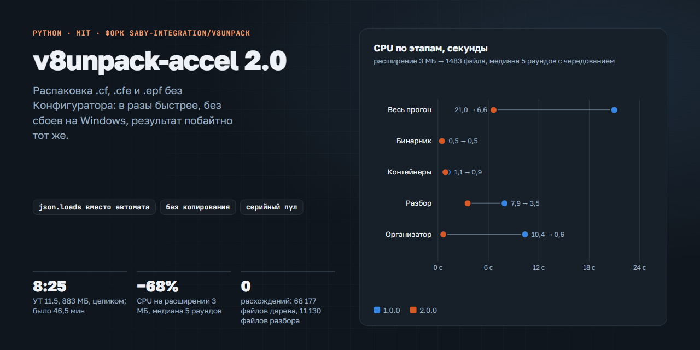

<h1 align="center">v8unpack-accel</h1>

<h4 align="center">Обёртки над v8unpack: распаковка .cf, .cfe и .epf без Конфигуратора в разы быстрее и без сбоев на Windows, результат побайтно тот же</h4>

<div align="center">
  <a href="LICENSE"></a>
  <a href="https://www.python.org/"></a>
  <a href="https://github.com/saby-integration/v8unpack"></a>
  <a href="CHANGELOG.md"></a>
</div>
<br/>

<p align="center"><a href="https://ivanbokhan84.github.io/v8unpack/"></a></p>

Страница проекта с графиками: **[ivanbokhan84.github.io/v8unpack](https://ivanbokhan84.github.io/v8unpack/)**.

[v8unpack](https://github.com/saby-integration/v8unpack) превращает бинарные контейнеры 1С в дерево JSON и BSL без платформы.
На расширениях по несколько мегабайт он работает, а на типовых конфигурациях в сотни мегабайт падал на гонках Windows
и разбирал формы часами. v8unpack-accel — набор модулей, которые подменяют методы v8unpack во время запуска.
Сам пакет не изменяется, результат распаковки побайтно тот же, что у штатного v8unpack.

Поддерживает **Ivan Bokhan**.

## Что даёт

| Что | Штатный v8unpack / 1.0.0 | 2.0.0 |
|---|---|---|
| УТ 11.5.27.93 (883 МБ → 68 177 файлов) целиком | 46,5 мин (1.0.0) | 8 мин 25 с, дерево побайтно то же |
| Раскладка по каталогам («Организуем код») на УТ 11.5 | 29 мин (1.0.0) | 31 с |
| Расширение 3 МБ → 1483 файла, CPU, медиана 5 раундов | 20,98 с (1.0.0) | 6,62 с (−68%) |
| Разбор тяжёлой формы 2 МБ, CPU | 537 с (штатный), 0,53 с (1.0.0) | 0,06 с |
| Крупные `.cf` в параллельном пуле | падение на WinError 32/5/87 (штатный) | серийный режим без сбоев |
| Вид метаданных `PaletteColor` (платформа 8.5.1) | пропускается (штатный) | распаковывается |

Методика и все прогоны — [отчёт о замерах](../docs/vanteam/Отчёт_замеров_v8unpack.html),
как это устроено — [статья](../docs/vanteam/Оптимизация_распаковки_v8unpack.html),
эксплуатация — [гайд](docs/raspakovka-v8unpack.md).

## Возможности

* **Разбор через `json.loads`.** Скобочный формат 1С переводится в JSON операциями уровня C. Файлы, которые не
  укладываются в правила автомата v8unpack, уходят в исходный автомат — результат тот же, просто медленнее.
* **Организатор без копирования.** `decode_stage_3` переносится в каталог результата одним переименованием; модули
  и формы, которые не меняются, не перезаписываются.
* **Быстрая запись JSON.** Свой сериализатор собирает тот же текст, что `json.dump(indent=2, ensure_ascii=False)`,
  и пишет файл одной записью.
* **Без сбоев на Windows.** Серийный пул вместо `multiprocessing`, ретраи `os.replace`/`os.remove` на WinError 32/5,
  вложенные контейнеры разбираются в памяти, пониженный приоритет процесса.
* **Исправления v8unpack.** Толерантный `decode_file` для текстового потока (ошибка `READ_TEXT_FILE`, в 1.2.13 не
  исправлена), вид метаданных `PaletteColor`, продолжение распаковки с третьего прохода.
* **Всё выключается.** Любое ускорение отключается переменной `V8UNPACK_DISABLE`; первая строка вывода показывает
  версию и включённые ускорения.

## Установка

Нужны Python 3.11 и v8unpack 1.2.13 (он тянет `tqdm`). `psutil` нужен только для `v8unpack_resume.py` и скриптов замеров.

```bash
pip install v8unpack==1.2.13 psutil
```

Скопируйте все файлы `vanteam/tools/*.py` в один каталог (например, `tools\` проекта 1С): модули подключают друг
друга из того же каталога. Сверить копию можно по sha256 из
[`releases/v8unpack-accel/v2.0.0/MANIFEST.json`](releases/v8unpack-accel/v2.0.0/MANIFEST.json).

## Запуск

```bash
python tools/check_cf.py "<файл.cf>"                                            # целостность контейнера
python tools/run_unpack.py "<файл.cf>" "<каталог_результата>" "<каталог_temp>"  # крупные .cf
python tools/v8unpack_serial.py "<файл.cfe>" "<каталог_результата>"             # расширения и обработки
python tools/v8unpack_resume.py "<TEMP>\tmpXXXX" "<каталог_результата>" "<журнал>"  # после обрыва на третьем проходе
```

```bat
set V8UNPACK_DISABLE=fastbrace,inplace
```

Допустимые имена: `fastparse`, `accum`, `fastbrace`, `jsonwrite`, `io`, `inplace`.

* Не передавайте `--descent`: это номер версии файла для инкрементальной сборки, а не глубина распаковки. Любое
  значение включает режим с побайтным сравнением O(N²), на крупной конфигурации распаковка встаёт.
* Временный каталог и результат держите на одном томе с запасом в 5–10 раз больше исходного файла: тогда
  организатор переносит дерево без копирования.

## Состав

| Путь | Что |
|---|---|
| `tools/` | 12 модулей v8unpack-accel 2.0.0 |
| `releases/v8unpack-accel/` | поставки 1.0.0 и 2.0.0: патчи 2.0.0 к 1.0.0, манифесты sha256, доказательства приёмки, `verify_release.py` |
| `bench/scripts/` | парный замер с чередованием, полный прогон с манифестом дерева, сверка деревьев, генератор отчёта |
| `docs/` | гайд по распаковке; `covers/` — генератор страницы проекта |
| `../docs/vanteam/` | статья и HTML-отчёт о замерах (открываются на странице проекта) |

## Проверка

```bash
python releases/v8unpack-accel/verify_release.py --replay --working   # хеши, патчи поверх 1.0.0, рабочая копия
python tools/v8unpack_fastparse_check.py "<TEMP>\tmpXXXX\decode_stage_1" 400  # разбор против исходного v8unpack
python bench/scripts/run_variant.py tools "<файл>" "<out>" "<temp>" result.json
python bench/scripts/compare_tree.py result.json "<эталонный каталог>" compare.json
```

После обновления v8unpack: сверка разбора на 400 файлах `decode_stage_1` без расхождений и полная распаковка
контрольного файла со сравнением дерева.

## Ограничения

* Проверено на v8unpack 1.2.13, Python 3.11, Windows 11.
* Серийный режим — одно ядро. Ограниченный параллелизм не проверялся на свободной машине.
* Пик памяти 2.0.0 на УТ 11.5 — около 1 ГБ.
* `.cf` через v8unpack обратно не собирается — только Конфигуратор; v8unpack меняет только BSL и текст.

## Лицензия

Код в `vanteam/` — [MIT](LICENSE), © 2026 Ivan Bokhan. Модули `v8unpack_fastparse.py`, `v8unpack_accum.py`,
`v8unpack_io.py`, `v8unpack_jsonwrite.py`, `v8unpack_organizer.py` содержат изменённые или переписанные функции
v8unpack (MIT, © 2015 infactum) — подробно в [NOTICE](NOTICE). Статьи, отчёт и гайд — CC BY 4.0
([`docs/vanteam/LICENSE.md`](../docs/vanteam/LICENSE.md)). Остальной репозиторий — v8unpack под своей
[лицензией MIT](../LICENSE).
